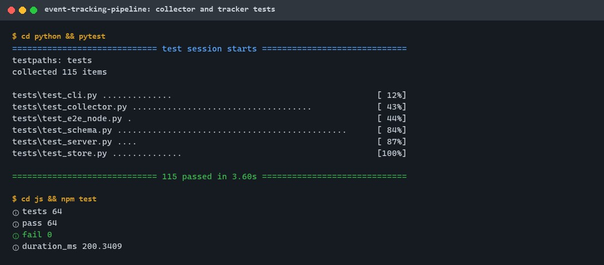
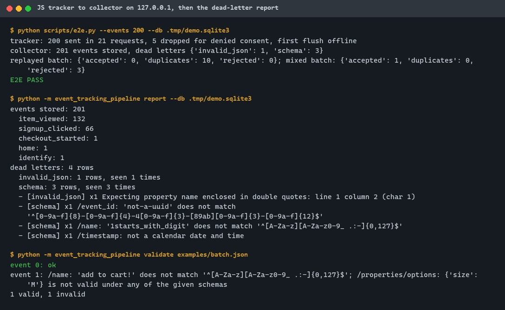
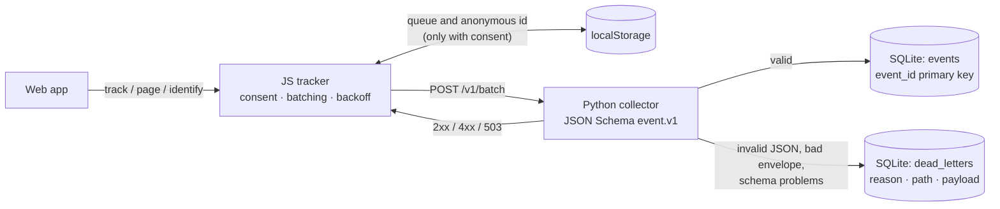
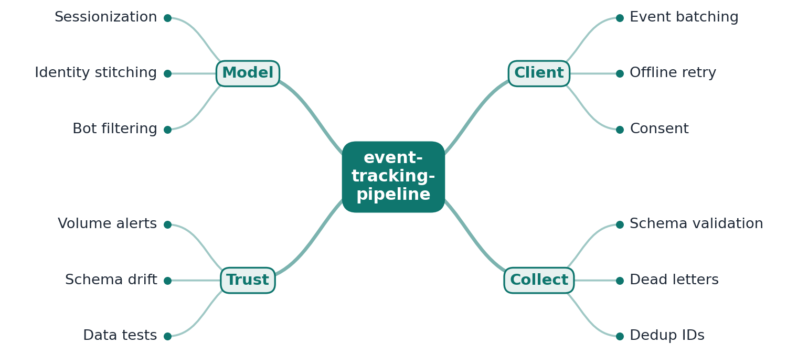

# event-tracking-pipeline

[](https://github.com/EquinoxWN/event-tracking-pipeline/actions/workflows/ci.yml)


> Product analytics you can trust: a tiny JS tracker, a collector that validates every event, and clean sessionized tables, with no third-party SDK.

Part of my **Data Engineering** list · Python · JS · core project

## Proof it works

115 Python and 64 JavaScript tests pass, and the dependency audits are clean:



The real tracker (in Node.js) sends 200 events to the real collector on 127.0.0.1, starting offline
and with one simulated network drop. All 200 arrive once, a replayed batch adds nothing, and the
bad input lands in the dead-letter table with the reason:



## Architecture

**What M1 runs today:**



**Full roadmap (M1 to M3):**



## How it works

_Steps 1 and 2 are built and tested (M1); the rest is on the [roadmap](#roadmap)._

1. A small JavaScript tracker batches events, retries when offline and respects consent settings.
2. A Python collector validates each event against a JSON Schema; bad events go to a dead-letter table instead of disappearing.
3. Every event carries a unique ID, so retries and duplicates are removed downstream.
4. SQL models sessionize events (30 minutes of inactivity), stitch anonymous and logged-in identities, and filter bots.
5. Volume checks alert when an event suddenly drops, which usually means a broken release.
6. Tests replay a day of synthetic traffic and assert that sessions and counts are exact.

In M1:

- **Tracker (`js/src`, no dependencies).** `createTracker({ transport, consent, ... })` gives
  `track`, `page`, `identify`, `setConsent`, `flush`, `online` and `stats`. Events get a random
  UUID that stays the same on every retry. A batch goes out at `batchSize` events (20) or after
  `flushIntervalMs` (5 s), cut to stay under 60,000 bytes.
- **Consent.** `pending` (default) keeps events in memory and sends nothing; `granted` saves the
  queue and anonymous id to storage and sends; `denied` records nothing and deletes both. A Global
  Privacy Control signal starts the tracker as `denied`.
- **Retry.** Network errors, timeouts, 408, 425, 429 and 5xx are retried with jittered exponential
  backoff (1 s to 60 s); each event is dropped after 6 failed attempts, and every drop is counted and
  reported. Other 4xx answers are not retried. Offline time does not count as a failed attempt
  ([ADR 0003](docs/adr/0003-tracker-retry-and-consent-rules.md)).
- **Collector (`python/src/event_tracking_pipeline`).** Validates each event against
  `schemas/event.v1.json` (JSON Schema Draft 2020-12) plus a real-date and valid-Unicode check, and
  writes good events and dead letters in one SQLite transaction. `event_id` is the primary key, so a
  retried batch is stored once. Dead letters keep the reason (`invalid_json`, `invalid_envelope`,
  `schema`), each problem with its JSON path, the payload and how often it was seen.
- **HTTP.** Standard-library threaded WSGI server on 127.0.0.1 by default: `POST /v1/batch`,
  `OPTIONS /v1/batch` (CORS only for configured origins), `GET /healthz`. Bodies over 256 KB get 413,
  batches over 100 events 400, a storage failure 503 so the tracker retries
  ([ADR 0002](docs/adr/0002-stdlib-wsgi-and-sqlite-for-m1.md)).

## Who it helps

- **Who:** Engineers adding product analytics to a web app without a third-party SDK, and analysts who need to know whether the counts are complete.
- **The problem:** Events vanish when users go offline, retries double-count, a renamed event or a malformed property is dropped somewhere and nobody can say how many were lost.
- **How to use it:** Run the collector next to your app, point the tracker's `fetchTransport` at it, and wire your consent banner to `setConsent`. `etp-collector report` shows how many events arrived and which were dead-lettered and why; `etp-collector validate` checks a tracking-plan example file against the schema before a release.

## Tech stack

| Area | In M1 | Planned |
|---|---|---|
| Client | JavaScript tracker for Node.js 24+ and browsers (ES modules, `fetch`, no dependencies) | Page-unload flush with `sendBeacon` |
| Server | Python 3.11+ collector: WSGI app, `wsgiref` threaded server, `jsonschema` (Draft 2020-12) | - |
| Storage | SQLite (`events`, `dead_letters`) | DuckDB / Postgres tables, sessionization in SQL (M2) |
| Tests | pytest, `node:test`, an end-to-end run over loopback HTTP | Replay of a day of synthetic traffic (M3) |
| Quality | ruff, `mypy --strict`, `node --check`, pip-audit, npm audit | Volume-drop alerts (M3) |

| Path | What it is |
|---|---|
| `js/src/tracker.js` | `createTracker`: events, consent, batching, retry |
| `js/src/queue.js`, `backoff.js`, `transport.js` | Bounded persistent queue, jittered backoff, `fetch` transport with timeout |
| `python/src/event_tracking_pipeline/schemas/event.v1.json` | The event contract |
| `python/src/event_tracking_pipeline/` | `schema`, `store`, `collector`, `server`, `cli` |
| `scripts/e2e.py`, `js/scripts/e2e-send.js` | End-to-end run (loopback only) |
| `examples/batch.json` | Example batch with one valid and one invalid event |

## Run it

Needs Python 3.11+ and Node.js 24+.

```bash
make setup   # install the collector and dev tools
make lint    # ruff, mypy --strict, node --check
make test    # pytest (includes the e2e run) and node --test
make e2e     # 200 events from the tracker to a local collector, counts asserted
make audit   # pip-audit and npm audit
```

Run the collector and look at what arrived:

```bash
python -m event_tracking_pipeline serve --db events.sqlite3 --port 8787 \
    --allow-origins http://localhost:3000
python -m event_tracking_pipeline report --db events.sqlite3
python -m event_tracking_pipeline validate examples/batch.json
```

Environment variables (CLI flags win): `ETP_DB` (database path, default `events.sqlite3`),
`ETP_HOST` (default `127.0.0.1`), `ETP_PORT` (default `8787`), `ETP_ALLOWED_ORIGINS`
(comma-separated browser origins for CORS, default none). `wsgiref` is not a hardened server: for
anything beyond local use, host the `Collector` WSGI app behind a production WSGI server or proxy.

In the page:

```js
import { createTracker, fetchTransport } from "./src/index.js";

const tracker = createTracker({
  transport: fetchTransport({ endpoint: "http://localhost:8787/v1/batch" }),
  storage: window.localStorage,
  globalPrivacyControl: navigator.globalPrivacyControl === true,
});
consentBanner.onAccept(() => tracker.setConsent("granted"));
consentBanner.onReject(() => tracker.setConsent("denied"));
window.addEventListener("online", () => tracker.online());
tracker.page("home");
tracker.track("item_viewed", { sku: "A-100", price: 19.99 });
```

## Tests and results

Latest local run (full detail in [docs/results/m1.md](docs/results/m1.md)):

| Check | Result |
|---|---|
| pytest | 115 passed |
| node --test | 64 passed, 0 failed |
| End to end, 200 events | 200 sent in 21 requests (one retry after a simulated drop); 201 stored, 4 dead letters, as expected |
| Replay of a delivered batch | `accepted 0, duplicates 10` |
| ruff, mypy --strict | clean |
| pip-audit, npm audit | no known vulnerabilities |

| Test file | Tests | What it proves |
|---|---|---|
| `python/tests/test_schema.py` | 46 | Each kind of bad event is reported at its JSON path; impossible dates and lone surrogates rejected |
| `python/tests/test_store.py` | 14 | Repeated batches stored once; failed batch writes nothing; 8 concurrent writers store each event once |
| `python/tests/test_collector.py` | 36 | Good events stored, bad ones dead-lettered; HTTP 400/404/405/411/413/415/503; CORS only for allowed origins |
| `python/tests/test_server.py` | 4 | Real HTTP on 127.0.0.1; 6 concurrent clients with overlapping retries store exactly 120 events |
| `python/tests/test_cli.py` | 14 | `validate`, `report`, environment defaults, bad arguments |
| `python/tests/test_e2e_node.py` | 1 | The JS tracker delivers to the collector with exact counts |
| `js/test/tracker.test.js` | 41 | Event shape, batching, consent, GPC, offline, retry and backoff, 4xx, attempt limit, reload, in-flight races, invalid calls |
| `js/test/queue.test.js` | 15 | Bounded queue, removal by id, attempt counts, persistence, corrupt storage |
| `js/test/backoff.test.js` | 4 | Growth, cap, jitter range, invalid arguments |
| `js/test/transport.test.js` | 4 | Request shape, timeout, network errors, bad endpoints |

What the numbers show: across an offline start and a network drop the tracker lost nothing, and
every event the collector received is either stored or dead-lettered with a reason. Two defects found
while writing the tests were fixed (lone surrogates crashed the SQLite insert; the identify rule fired
on events without a `type`). CI has not run yet (not pushed), and no browser was used: the tracker is
tested in Node.js. Quality check against the 10 rules, with 15 hand mutations, all killed:
[docs/quality/2026-11-01.md](docs/quality/2026-11-01.md).

## Roadmap

**M1** (≈15 h)
- [x] Write `docs/rfc/0001-design.md`: problem, goals, non-goals, chosen design
- [x] A small JavaScript tracker batches events, retries when offline and respects consent settings.
- [x] A Python collector validates each event against a JSON Schema; bad events go to a dead-letter table instead of disappearing.

**M2** (≈20 h)
- [ ] Every event carries a unique ID, so retries and duplicates are removed downstream.
- [ ] SQL models sessionize events (30 minutes of inactivity), stitch anonymous and logged-in identities, and filter bots.

**M3** (≈25 h)
- [ ] Volume checks alert when an event suddenly drops, which usually means a broken release.
- [ ] Tests replay a day of synthetic traffic and assert that sessions and counts are exact.
- [ ] Publish the proof below with real numbers

## Proof

What this repo must show before it counts as done:

- Replay tests with exact session counts, and a dead-letter report showing bad events caught.

| Result | Value |
|---|---|
| Dead-letter report (M1) | 3 schema and 1 invalid-JSON dead letters caught in the e2e run, each with its reason; see [Proof it works](#proof-it-works) |
| Exact session counts | Not measured yet (sessionization is M2, the day-long replay M3) |

## Known limitations

- The tracker is tested in Node.js only; real browser `localStorage`, `keepalive` and `online` events are not exercised in M1.
- Events recorded while consent is pending are lost if the page closes before a decision (nothing is stored without consent).
- A collector outage longer than about six backoff rounds drops the affected events (counted and reported).
- The collector has no sender authentication or rate limiting, and `wsgiref` is not meant for public traffic.
- SQLite serialises writes; no throughput was measured.
- Client timestamps are stored as sent; clock-skew correction comes with sessionization (M2).

## Why it matters

- **Interview angle:** 'Design an analytics pipeline like Segment or Google Analytics'.
- **Upstream I'm contributing to:** Snowplow or RudderStack: tracker docs or tests.

## Design docs

- [RFC 0001: design](docs/rfc/0001-design.md)
- [ADR 0001: record architecture decisions](docs/adr/0001-record-architecture-decisions.md)
- [ADR 0002: standard-library WSGI server and SQLite for the M1 collector](docs/adr/0002-stdlib-wsgi-and-sqlite-for-m1.md)
- [ADR 0003: tracker retry and consent rules](docs/adr/0003-tracker-retry-and-consent-rules.md)
- [M1 results](docs/results/m1.md)
- [Quality check against the 10 rules (2026-11-01)](docs/quality/2026-11-01.md)

## Scope

This is a learning and portfolio system, not a hosted production service. Everything runs locally;
nothing is sent to any analytics service, and the end-to-end script only accepts loopback addresses.

## Security and contributing

- Every GitHub Action is pinned to a commit SHA; workflows run read-only, without persisted credentials.
- Dependabot update pull requests are paused (`open-pull-requests-limit: 0`) so the repository keeps a single `main` branch; dependencies are updated by hand and checked by the CI audit.
- The collector binds to 127.0.0.1 by default, caps bodies and batches, and sends CORS headers only to configured origins.
- Report vulnerabilities privately: see [SECURITY.md](SECURITY.md). To contribute, see [CONTRIBUTING.md](CONTRIBUTING.md).

## License

MIT, see [LICENSE](LICENSE).
